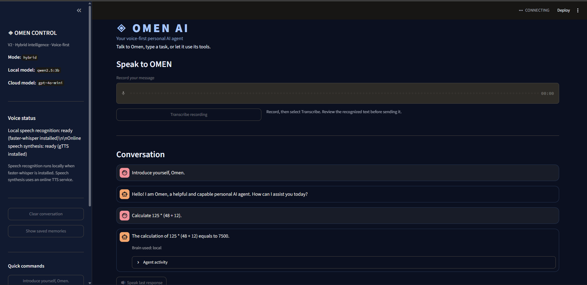
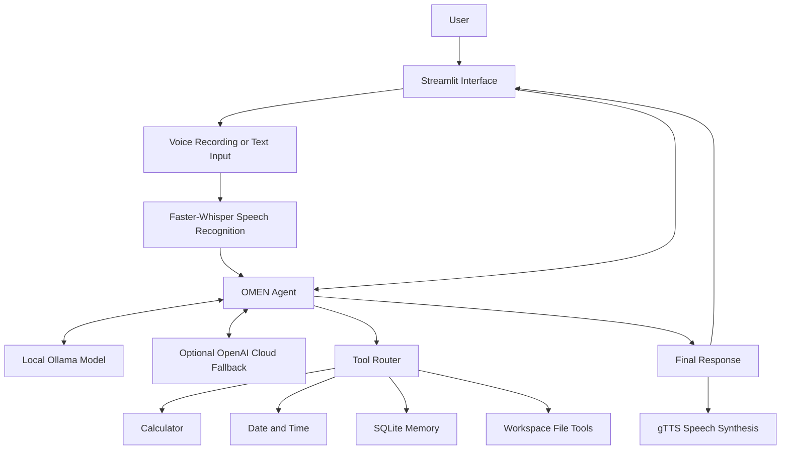

# OMEN AI V2 — Hybrid Voice-First Personal AI Agent

**OMEN AI V2** is a Python-based personal AI agent designed to combine conversational AI, voice interaction, persistent memory and practical tool execution in one interface.

Built using Python, Streamlit, Ollama, SQLite and optional OpenAI API integration, OMEN supports local-first AI conversations with an optional cloud fallback.

The project explores how locally hosted language models can be combined with memory, voice processing and agent-style tool execution to create a personal AI assistant.

## Key Features

- **Local AI conversations:** Uses Ollama to communicate with locally hosted language models.
- **Hybrid AI architecture:** Supports optional OpenAI API fallback when configured.
- **Voice input:** Browser-based audio recording and speech recognition using Faster-Whisper.
- **Voice output:** Generates spoken responses using gTTS (internet connection required).
- **Persistent memory:** Stores user-requested notes in an SQLite database.
- **Agent tool execution:** Supports calculator, date/time, memory and workspace file tools.
- **Multilingual speech recognition:** Faster-Whisper can recognise multiple languages.
- **Controlled file access:** Workspace boundary restrictions and file-size limits.
- **Bounded tool execution:** Limits the number of agent tool-use rounds.

## Application Preview

Screenshots of the running application will be added here.

<!-- Add screenshots to the screenshots/ directory before enabling these images. -->



## Technology Stack

| Component | Technology |
|---|---|
| Programming language | Python |
| User interface | Streamlit |
| Local LLM runtime | Ollama |
| Default local model | Qwen 2.5 3B |
| Optional cloud AI | OpenAI API |
| Speech recognition | Faster-Whisper |
| Speech synthesis | gTTS |
| Persistent storage | SQLite |
| Configuration | Environment variables |

## System Architecture



## Project Structure

```text
omen-ai-v2/
│
├── app.py
│
├── omen/
│   ├── __init__.py
│   ├── agent.py
│   ├── config.py
│   ├── memory.py
│   ├── tools.py
│   └── voice.py
│
├── workspace/
│   └── README.txt
│
├── requirements.txt
├── requirements-voice.txt
├── .env.example
├── .gitignore
├── LICENSE
└── README.md
```

## Requirements

- Windows, Linux or macOS
- Python 3.10 or later
- Ollama installed and running
- A compatible local language model
- Internet connection for initial setup and gTTS speech synthesis
- Optional OpenAI API key for cloud fallback

The default local model is `qwen2.5:3b`.

Model performance depends on available system memory and hardware.

## Installation and Setup

### 1. Clone the repository

```bash
git clone https://github.com/shantanu-100825/omen-ai-companion.git
cd omen-ai-companion
```

### 2. Install Ollama

Download Ollama:

https://ollama.com/download

Pull the default model:

```bash
ollama pull qwen2.5:3b
```

Make sure the Ollama service is running.

### 3. Create a Python virtual environment

```bash
python -m venv .venv
```

Activate it on Windows PowerShell:

```powershell
.venv\Scripts\Activate.ps1
```

### 4. Install dependencies

Install the core dependencies:

```bash
pip install -r requirements.txt
```

For voice functionality:

```bash
pip install -r requirements-voice.txt
```

Faster-Whisper and its dependencies may take additional time to install.

### 5. Configure OMEN

The project includes `.env.example` as a configuration reference.

Copy it to `.env` if you want to maintain your settings in a separate file. The current starter configuration reads environment variables directly; it does not automatically load `.env`.

For PowerShell, configure the local model:

```powershell
$env:OLLAMA_BASE_URL="http://localhost:11434"
$env:OLLAMA_MODEL="qwen2.5:3b"
$env:OMEN_PROVIDER="local"
```

To enable optional hybrid mode:

```powershell
$env:OMEN_PROVIDER="hybrid"
$env:OPENAI_API_KEY="YOUR_API_KEY"
$env:CLOUD_MODEL="gpt-4o-mini"
```

Replace the API key placeholder with your own key.

**Security:** Never upload `.env` files containing credentials or expose API keys in a public repository.

### 6. Launch OMEN

```bash
streamlit run app.py
```

Open the application in your browser:

http://localhost:8501

## AI Provider Modes

OMEN supports three provider configurations:

| Provider | Behaviour |
|---|---|
| `local` | Uses the local Ollama model |
| `cloud` | Uses the configured OpenAI-compatible API |
| `hybrid` | Uses local AI first, with optional cloud fallback |

Cloud API usage may incur charges. Local mode does not require a paid AI API.

## Voice Interaction Workflow

1. Open the OMEN application.
2. Use the browser recording control to record a message.
3. Select **Transcribe recording**.
4. Review or edit the recognised text.
5. Select **Send voice message**.
6. Use **Speak last response** to hear the generated answer.

Speech recognition uses Faster-Whisper locally when installed.

Speech synthesis currently uses gTTS, which requires an internet connection and currently provides English speech output in this starter.

## Memory System

OMEN uses SQLite for persistent note storage.

The memory system supports:

- Saving notes when explicitly requested.
- Retrieving previously stored notes.
- Maintaining information across application sessions.

The database is created locally and should not be committed if it contains personal information.

## Security and Safety Considerations

The project incorporates several basic safeguards:

- Restricted arithmetic parsing instead of unrestricted expression evaluation.
- Workspace path boundary checks.
- File-size limits for workspace file operations.
- Bounded agent tool-execution rounds.
- Explicit user requests for saving memory.

These measures provide basic application-level safeguards and are not a substitute for a comprehensive security audit.

## Current Limitations

- Voice interaction uses push-to-record rather than continuous listening.
- Wake-word activation is not implemented.
- Speech synthesis currently uses online gTTS.
- Multilingual speech output is not currently implemented.
- Response quality depends on the selected language model.
- Local model speed depends on the available hardware.
- The current interface is built with Streamlit rather than a native desktop framework.

## Future Development Roadmap

Potential future enhancements include:

- Native Windows desktop interface.
- Wake-word activation and continuous voice interaction.
- Improved offline speech synthesis.
- Multilingual voice output.
- Expanded persistent memory and contextual retrieval.
- More advanced autonomous agent planning.
- User-controlled permissions for agent actions.
- Improved UI and customisable assistant personas.

## License

This project is distributed under the license included in the repository.

Please review the `LICENSE` file for usage and redistribution terms.

## Author

**Shantanu Tantak**

GitHub: https://github.com/shantanu-100825

---

*OMEN AI V2 is an experimental personal AI agent project exploring local language models, voice interaction, memory and agent-based tool execution.*